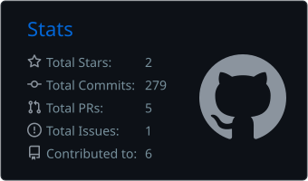
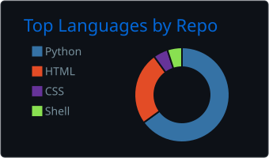

# Hi, I'm Jakub Świdłowski 👋

**DevOps Engineer @ Comarch** | Kubernetes • Helm • CI/CD • AWS • GitOps

---

### 👨‍💻 About Me

- ⚙️ **Currently:** Working as a **DevOps Engineer at Comarch** in Poznań— designing CI/CD pipelines, authoring **Helm & umbrella charts**, building multi-architecture container images (ARM simulation via **QEMU**), and deploying workloads across on-prem **Kubernetes** clusters and **AWS**.
- 🧩 **Engineering Background:** Previously worked at **PSI Polska** developing **Java** applications, building automated test suites, and troubleshooting production environments, giving me a developer-first perspective on infrastructure reliability.
- 🎓 **Education:** **BSc in Computer Science & Econometrics** from **Poznań University of Economics and Business (UEP)** (thesis on empirical energy consumption of sorting algorithms using Python & Intel RAPL).
- 🔭 **Origin Story:** Started out studying astronomy, discovered a passion for programming, and evolved into building self-healing cloud and bare-metal infrastructure.

---

### 🚀 Featured Infrastructure & DevSecOps Projects

| Project | Stack | Highlights |
| :--- | :--- | :--- |
| **[Bare-Metal K3s GitOps Homelab](https://github.com/jakubswi/homelab)** | `K3s` • `ArgoCD` • `Ansible` • `Helm` • `Cloudflare` • `AWS ESO` • `OPA` | Zero-trust bare-metal Kubernetes platform provisioned via Ansible and reconciled with ArgoCD `ApplicationSet`. Features outbound HA QUIC Cloudflare Tunnels, Split-Horizon DNS (AdGuard + MetalLB), AWS Secrets Manager integration via ESO, and a DevSecOps CI pipeline (Gitleaks, Trivy SARIF, SonarCloud, Kubeconform, Rego v1 policy gates, `dyff` PR diffs). |
| **[Spotify Wrapped Multiplayer Game](https://github.com/jakubswi/spotify-wrapped-game)** | `Go` • `Angular` • `Docker` • `GitHub Actions` • `Kubernetes` | Real-time Kahoot-style music guessing game powered by WebSockets and Spotify OAuth. Built with multi-stage hardened containers, automated CI security/quality gates, and GitOps deployment via commit-SHA image promotion. |

---

### 🛠️ Tech Stack

**Orchestration, GitOps & Cloud**

**IaC, Containers & Linux**

**CI/CD, DevSecOps & Observability**

**Languages & Scripting**

---

### 📊 GitHub Activity

  
  

